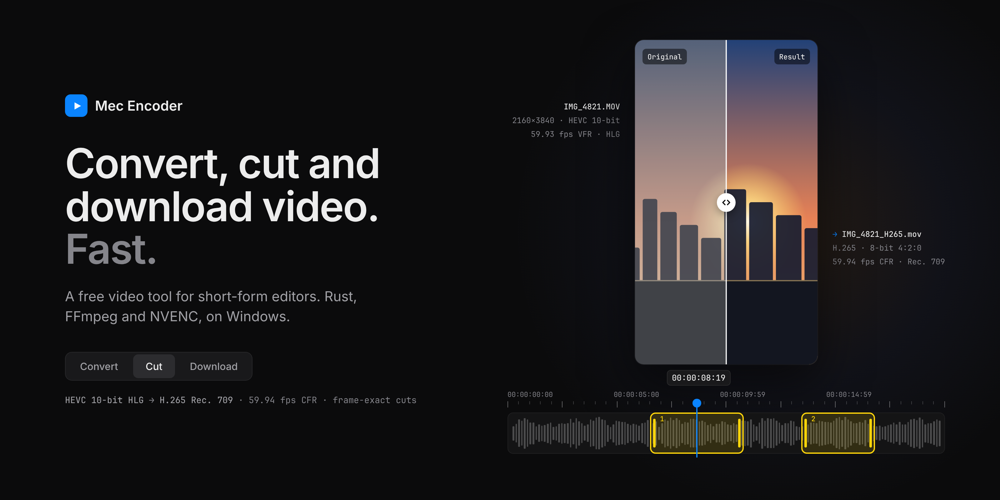
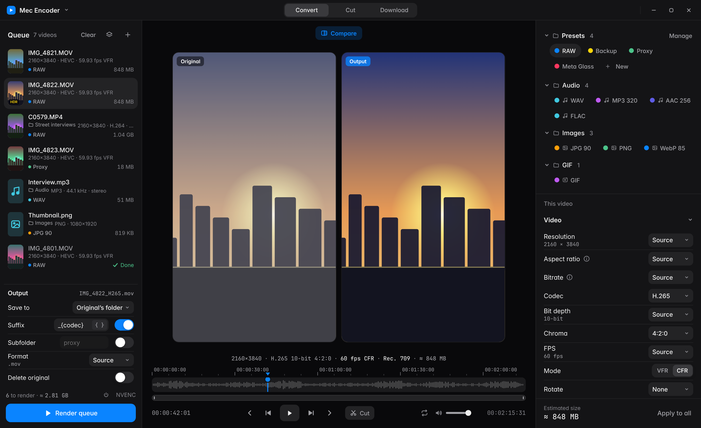
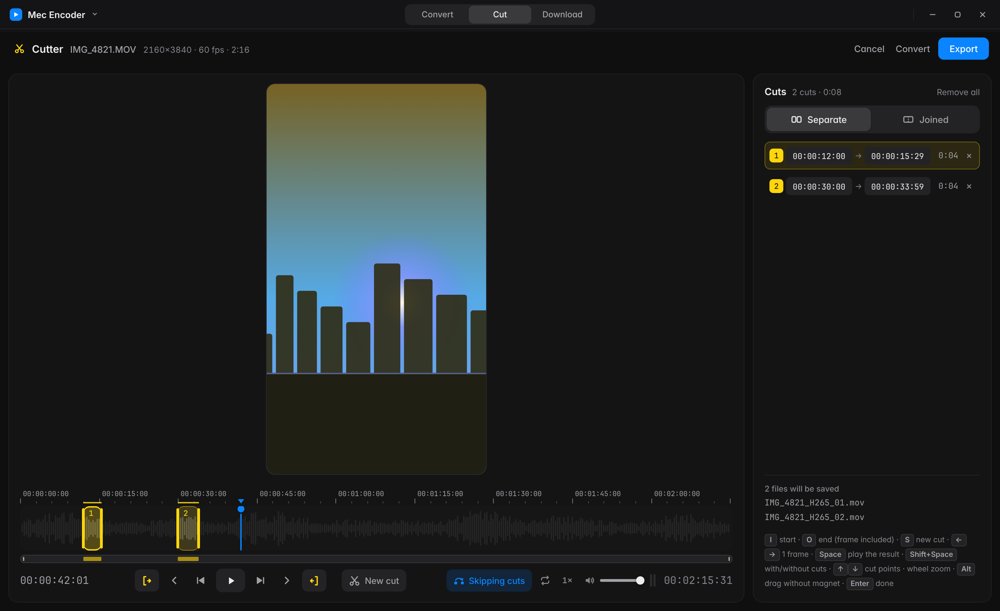
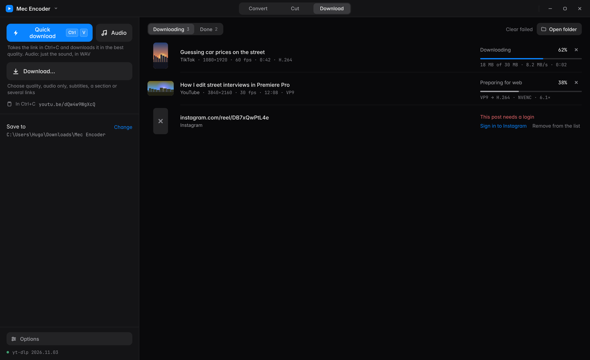
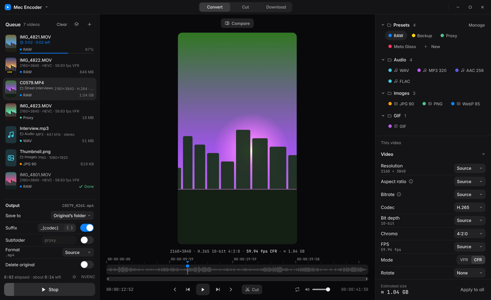
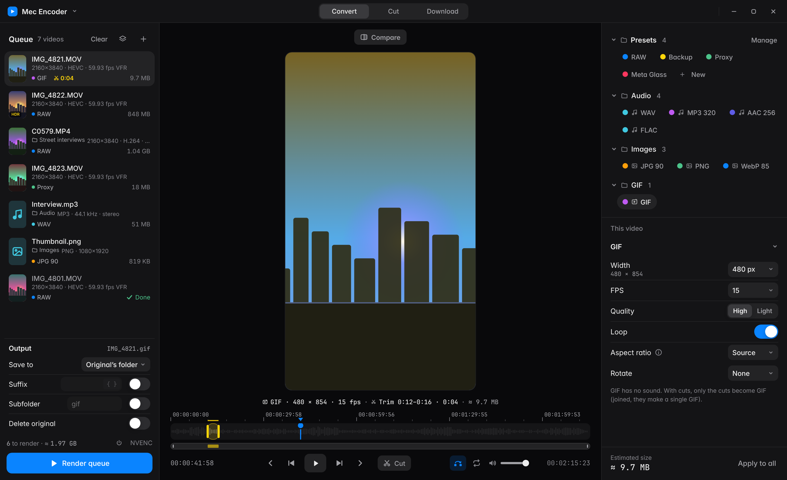

# Mec Encoder

**English** · [Português](README.pt-BR.md)

A fast video tool for Windows, made for short-form video editors: **convert, cut and download** in one app.
Built with **Rust** (Tauri 2) and **FFmpeg**, encoding with **NVIDIA NVENC**.

  
  

  
  

**Convert**
- Converts iPhone footage to a **constant frame rate** (e.g. 59.94 fps), keeping bitrate and quality.
- Converts **iPhone HDR (HLG) to Rec. 709** with real tone mapping (the same Hable filter chain HandBrake uses), automatically when the video is HDR.
- **Keeps camera files as they are** when you want: codec, chroma (4:2:2), bit depth, frame rate, .mp4/.mov, PCM audio and timecode on Source.
- Creates **proxies** at 25% with automatic suffix and subfolder.
- **Audio** (WAV, MP3, AAC, FLAC), **images** (JPG, PNG, WebP) and **video to GIF** (width, fps, quality, loop).
- **Queue where each video keeps its own preset**; drop files or whole folders; render one video or the whole queue.
- **Output preview** with **Compare** to see the original side by side.
- **Presets** you can create, share and import from Shutter Encoder (`.enc`).

**Cut**
- Mark one or many cuts on the timeline (I, O, S), **frame-exact**, saved separate or joined.
- **Export** only cuts: everything stays as in the original (codec, resolution, fps, bitrate, audio). **Convert** sends the cuts to the Convert tab.
- Play the result skipping what was cut, loop, speed, waveform and zoom on the timeline.

**Download**
- **Quick download**: takes the link in Ctrl+C and downloads it in the best quality, no questions asked. Audio only in WAV, M4A, MP3 or FLAC.
- **Ready for the web** by default (H.264 + AAC), so the video goes straight to WhatsApp and social media.
- Choose quality, subtitles, thumbnail, a section, several links or a playlist; sign in to Instagram, X and others for private posts.
- Send a downloaded video straight to the Cutter.

English, Portuguese and 8 more languages; Studio, dark, light and OLED themes.

> Test builds. See the [roadmap](ROADMAP.md) and the [changelog](CHANGELOG.md).

## Download

Get the latest version on the [Releases](https://github.com/hugomec7/Mec-Encoder/releases) page (Windows 10/11, 64-bit):

- `MecEncoder_x.y.z_x64.msi` — installer
- `MecEncoder_x.y.z_x64_portable.zip` — portable, unzip and open `Mec Encoder.exe`

FFmpeg comes bundled. NVENC needs an NVIDIA GPU; without one, Mec Encoder uses the CPU.
When a new version is out, an **Update** button appears at the top of the app. Presets and settings are kept (they live in `%APPDATA%\com.hugomec.mecencoder`).

## Try the interface

Open `app/ui/index.html` in a browser. Without the app it runs in demo mode with sample videos.
Add `?lang=pt` to the address for Portuguese.

## Credits

Inspired by [Shutter Encoder](https://github.com/paulpacifico/shutter-encoder) by Paul Pacifico. Mec Encoder is a new app and contains none of its code.
Bundles [FFmpeg](https://ffmpeg.org) (GPL build by BtbN). Inter and JetBrains Mono typefaces (SIL Open Font License). Made by [@hugoeditor_](https://x.com/hugoeditor_).
