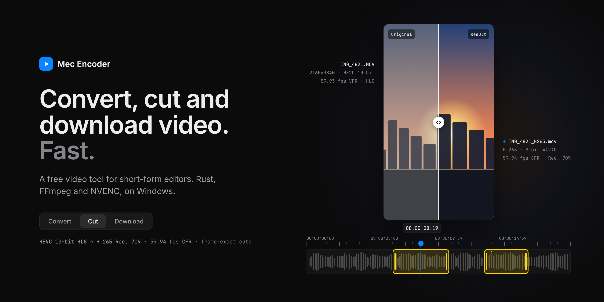
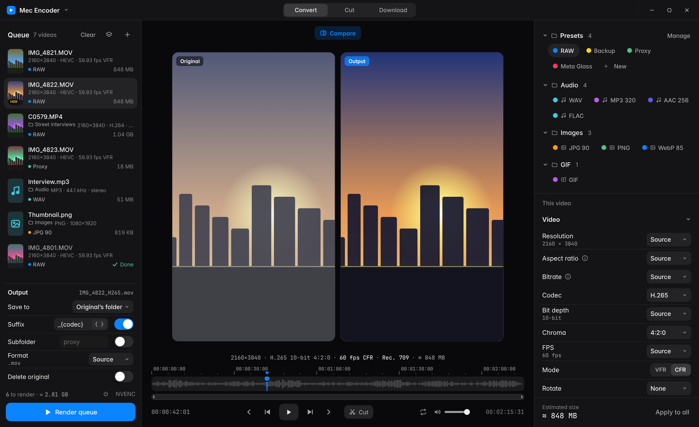
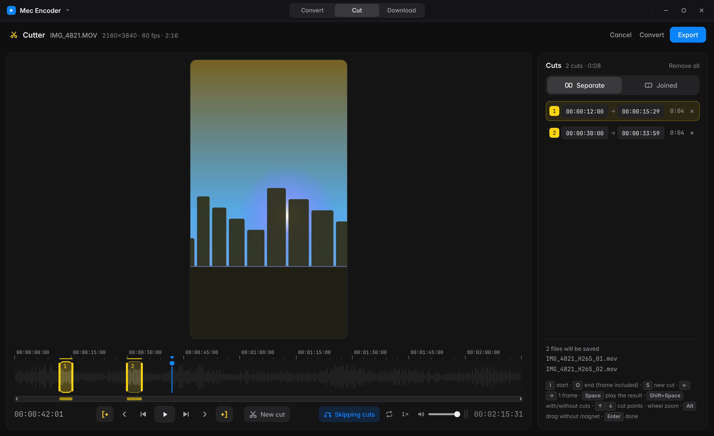
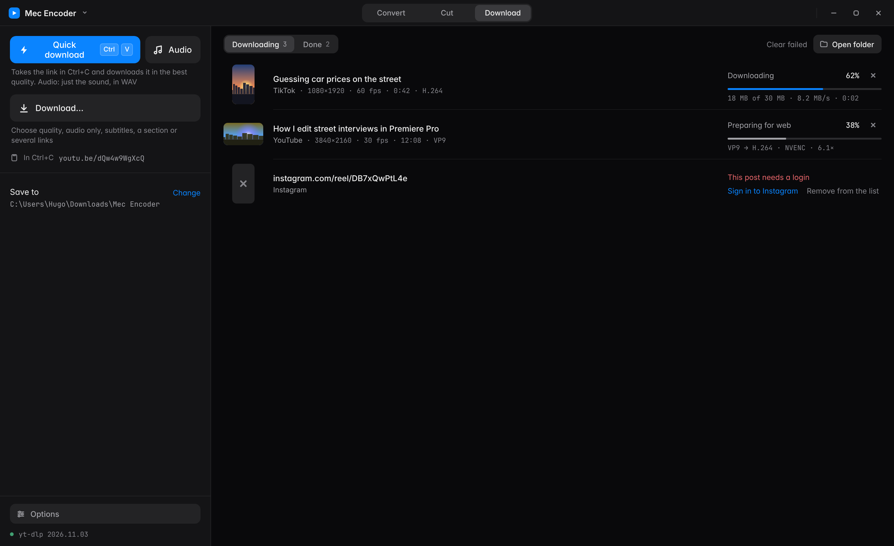
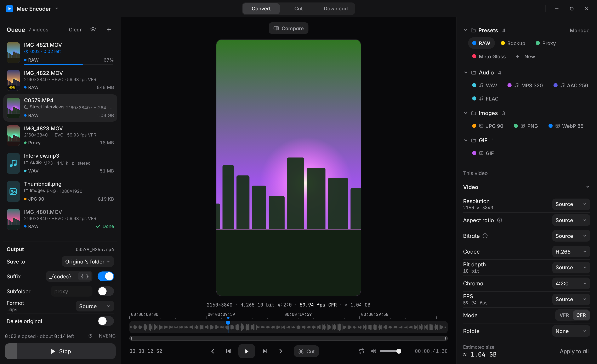
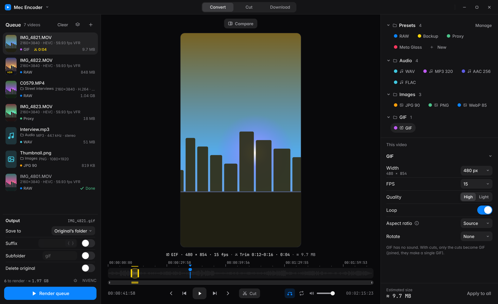

# Mec Encoder

[English](README.md) · **Português**

Ferramenta de vídeo para Windows, rápida, feita para editores de vídeos curtos: **converter, cortar e baixar** num app só.
Feito em **Rust** (Tauri 2) com **FFmpeg** e encode por **NVIDIA NVENC**.

  
  

  
  

**Converter**
- Converte vídeos do iPhone para **frame rate constante** (ex.: 59,94 fps), mantendo bitrate e qualidade.
- Converte **HDR do iPhone (HLG) para Rec. 709** com tone mapping de verdade (a mesma sequência de filtros Hable do HandBrake), automaticamente quando o vídeo é HDR.
- **Mantém o arquivo da câmera como está** quando você quer: codec, croma (4:2:2), profundidade, frame rate, .mp4/.mov, áudio PCM e timecode em Original.
- Gera **proxy** em 25% com sufixo e subpasta automáticos.
- **Áudio** (WAV, MP3, AAC, FLAC), **imagens** (JPG, PNG, WebP) e **vídeo para GIF** (largura, FPS, qualidade, repetir).
- **Fila em que cada vídeo tem o próprio preset**; arraste arquivos ou pastas inteiras; renderize um vídeo só ou a fila inteira.
- **Prévia do resultado** com **Comparar** para ver o original lado a lado.
- **Presets** para criar, compartilhar e importar do Shutter Encoder (`.enc`).

**Cortar**
- Marque um ou vários cortes na linha do tempo (I, O, S), **no quadro exato**, separados ou juntos.
- **Exportar** só corta: tudo fica como no original (codec, resolução, fps, bitrate, áudio). **Converter** leva os cortes para a aba Converter.
- Toque o resultado pulando o que foi cortado, em loop, com velocidade, forma de onda e zoom na linha do tempo.

**Baixar**
- **Download rápido**: pega o link do Ctrl+C e baixa na melhor qualidade, sem perguntar nada. Só o áudio em WAV, M4A, MP3 ou FLAC.
- **Pronto para web** por padrão (H.264 + AAC): o vídeo vai direto para o WhatsApp e as redes.
- Escolha qualidade, legenda, miniatura, um trecho, vários links ou uma playlist; entre no Instagram, X e outros para posts privados.
- Mande um vídeo baixado direto para o Cortador.

Português, inglês e mais 8 idiomas; temas Estúdio, escuro, claro e OLED.

> Builds de teste. Veja o [plano](ROADMAP.md) e as [novidades](CHANGELOG.md).

## Baixar

Baixe a versão mais recente na página [Releases](https://github.com/hugomec7/Mec-Encoder/releases) (Windows 10/11, 64-bit):

- `MecEncoder_x.y.z_x64.msi` — instalador
- `MecEncoder_x.y.z_x64_portable.zip` — portátil, é só descompactar e abrir o `Mec Encoder.exe`

O FFmpeg já vem junto. O NVENC precisa de placa NVIDIA; sem ela, o Mec Encoder usa a CPU.
Quando sair uma versão nova, aparece um botão **Atualizar** no topo do app. Presets e configurações continuam (ficam em `%APPDATA%\com.hugomec.mecencoder`).

## Ver a interface

Abra `app/ui/index.html` no navegador. Sem o app instalado, ela roda em modo demonstração com vídeos de exemplo.
Coloque `?lang=pt` no endereço para ver em português.

## Créditos

Inspirado no [Shutter Encoder](https://github.com/paulpacifico/shutter-encoder), de Paul Pacifico. O Mec Encoder é um app novo e não usa código dele.
Inclui o [FFmpeg](https://ffmpeg.org) (build GPL do BtbN). Fontes Inter e JetBrains Mono (SIL Open Font License). Por [@hugoeditor_](https://x.com/hugoeditor_).
